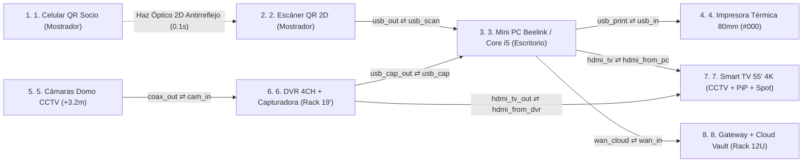

# GIMNASIO RED GYM a Escala Real: Mostrador de Recepción ➔ Techo CCTV (+3.2m) ➔ Rack 19" ➔ Smart TV 55" PiP

_Simulador Espacial y Anatómico 3D v3.0 • Ambientes Reales, Proporción Física Exacta, Boletas #000 y Smart TV con Cámaras + Publicidad Rotativa_

> Documento generado automáticamente por **Anatomy3D** · 2026-10-20T22:06:58.609Z

## Resumen ejecutivo

| Métrica | Valor |
|---|---|
| Equipos | 8 |
| Componentes internos | 43 |
| Etapas de proceso | 27 |
| Cables | 7 |
| Procesos trazables | 3 (20 pasos) |
| Pares de colisión verificados | 39566 |
| Auditoría geométrica | ✅ aprobada (0 errores, 0 advertencias) |
| **Puntaje de calidad** | **100/100** |

## Topología

## Fichas de equipo

### 1. Smartphone del Socio con Carné Digital QR (o Tarjeta PVC RED GYM)

> **Ubicación:** Mostrador de Recepción • Zona de Ingreso de Socios (z = +10) · **Dimensiones Reales:** 7.6 × 15.8 × 0.8 cm (Smartphone OLED / Carné PVC)

Teléfono del socio presentado frente al lector en la esquina de acceso del mostrador de recepción (z = +10). Sus dimensiones físicas reales (7.6 × 15.8 cm) son las más compactas de la escena, mostrando en pantalla el Carné Digital con código QR y sello de agua de GIMNASIO RED GYM.

| Especificación | Valor |
|---|---|
| Ubicación Física | Mostrador Recepción • Esquina Acceso (z = +10) |
| Dimensiones Reales | 7.6 × 15.8 × 0.8 cm (Escala 1:1) |
| Formato Credencial | Carné Digital PWA (`/`) o Tarjeta PVC Física |
| Modo Offline | Service Worker `rd-v4.3` (abre sin internet) |

**Anatomía interna**

- **Placa Lógica Smartphone ARM64** — Ejecuta la PWA de GIMNASIO RED GYM con estadísticas, rutinas y carné QR.
- **Controlador Display AMOLED & Brillo** — Renderiza el vector SVG del código QR con bordes nítidos (`crispEdges`).
- **Motor de Token QR (`RDFIT:Mxxxx`)** — Genera la credencial única vinculada al DNI y vigencia del socio.
- **Caché Offline Service Worker (`rd-v4.3`)** — Permite abrir el carné QR en la puerta del gimnasio incluso sin señal móvil.
- **Batería Polímero de Litio 5000 mAh** — Suministro energético regulado del teléfono.

**Proceso interno**

1. **Apertura Instantánea del Carné PWA** — El socio abre su carné digital de GIMNASIO RED GYM (con o sin internet).
2. **Despliegue de Código QR Oficial** — Se muestra el código QR de alto contraste con marca de agua del gimnasio.
3. **Presentación frente al Escáner 2D** — El socio acerca su pantalla a 10 cm del lector manos libres sobre el mostrador.

### 2. Lector Óptico 2D Manos Libres (Honeywell Orbit HF680 / Netum NT-2050M)

> **Ubicación:** Mostrador de Recepción • Pedestal de Escaneo Frontal (z = +10) · **Dimensiones Reales:** 8.5 × 8.8 × 14.0 cm (Escáner 2D de Presentación)

Escáner óptico 2D Imager de presentación ubicado sobre el mostrador de recepción (z = +10) mirando hacia el teléfono del socio. Tiene base circular pesada, cuello articulado y tambor óptico antirreflejo que lee pantallas con brillo mínimo o vidrio templado rajado en 0.1 segundos.

| Especificación | Valor |
|---|---|
| Ubicación Física | Mostrador Recepción • Frente al Socio (z = +10) |
| Dimensiones Reales | 8.5 × 8.8 × 14.0 cm (Manos Libres) |
| Modelos Exactos | Netum NT-2050M o Honeywell Orbit HF680 |
| Sensor Óptico | CMOS 1280×800 Megapíxel (60 fps) + USB-HID |

**Anatomía interna**

- **Placa Base Óptica MIPI CSI** — Interconecta el sensor CMOS de obturador global con el decodificador ASIC.
- **Sensor CMOS Megapíxel 1280×800 (60 fps)** — Captura 60 imágenes por segundo sin importar si la pantalla tiene 15% de brillo.
- **Lente Asférico Antirreflejo Celulares** — Suprime reflejos especulares en micas de vidrio templado.
- **Matriz Iluminación Blanca Cálida** — Ilumina códigos QR impresos o en pantalla sin encandilar.
- **Chip ASIC Decodificador Reed-Solomon** — Reconstruye el código `RDFIT:SOCIO` en menos de 100 milisegundos.
- **Buzzer Piezoeléctrico 85 dB & USB-HID** — Emite el beep de confirmación y envía la ráfaga USB con tecla ENTER.

**Proceso interno**

1. **Captura Óptica Antirreflejo (60 fps)** — El sensor CMOS lee el QR desde el celular o carné sin rebotes de luz.
2. **Decodificación Reed-Solomon en 0.1s** — El chip ASIC extrae el token del socio con cero lecturas fallidas.
3. **Beep Verde + Envío USB-HID a Mini PC** — Suena la confirmación y transmite la trama por el cable USB sobre el escritorio.

| Puerto | Tipo | Cable | Conectado a |
|---|---|---|---|
| Salida Cable USB-HID a Mini PC (`usb_out`) | rj45 | c_scan_pc | minipc_pos.usb_scan |

### 3. Mini PC de Recepción (Beelink Mini S12 Pro N100 / Core i5 • 16GB RAM • 512GB NVMe • Dual-HDMI)

> **Ubicación:** Mostrador de Recepción • Junto al Monitor del Cajero (z = +10) · **Dimensiones Reales:** 11.5 × 10.2 × 4.1 cm (Chasis Compacto Mini PC NUC)

Cerebro operativo del gimnasio situado sobre el escritorio de recepción (z = +10) junto al monitor del cajero. Su chasis compacto NUC (11.5 × 10.2 cm) cuenta con botón de encendido rojo, puertos USB 3.2 azules y doble salida HDMI (una al monitor del cajero y otra hacia la Smart TV 55").

| Especificación | Valor |
|---|---|
| Ubicación Física | Mostrador Recepción • Centro (z = +10) |
| Dimensiones Reales | 11.5 × 10.2 × 4.1 cm (Formato NUC) |
| Configuración | Intel Core i5 / N100 • 16GB RAM • 512GB NVMe |
| Video Dual | HDMI 1 (Monitor Caja) + HDMI 2 (Smart TV 55") |

**Anatomía interna**

- **Placa Base Mini-ITX / NUC 6 Capas** — Placa compacta de alta densidad con VRM digital y protección ESD.
- **CPU Intel Core i5 / N100 + Bloque Cobre** — Ejecuta `server.js`, valida membresías en <2 ms y controla el arqueo de caja.
- **Turbina Radial Blower PWM Silenciosa** — Ventilador centrífugo que disipa el calor durante las 16h de operación diaria.
- **16 GB RAM DDR4-3200 SO-DIMM** — Mantiene en memoria el padrón de socios, sesiones y colas SSE.
- **SSD M.2 NVMe PCIe 512 GB (`gym.json`)** — Almacenamiento local instantáneo a prueba de cortes de luz o caídas de red.
- **Controladora Dual-HDMI 4K + Captura USB 3.2** — Recibe las cámaras del DVR por USB 3.0 y proyecta `/display.html` a la TV 55".

**Proceso interno**

1. **Recepción USB-HID (QR) + Video DVR** — Recibe la trama del escáner 2D y el flujo 1080p de las 4 cámaras.
2. **Validación de Socio, Asistencia y Caja** — Verifica vigencia, registra asistencia y dispara la alerta SSE hacia la Smart TV.
3. **Renderizado de Ticket #000000 Negro Puro** — Genera la boleta monocromática de alto contraste sin escalas de grises.
4. **Guardado NVMe Local + Sincro Cloud** — Persiste en el SSD M.2 en <1 ms y replica al instante hacia Upstash Redis.

| Puerto | Tipo | Cable | Conectado a |
|---|---|---|---|
| Entrada USB-HID desde Escáner 2D (`usb_scan`) | rj45 | c_scan_pc | scanner_2d.usb_out |
| Salida USB a Impresora Térmica 80mm (`usb_print`) | rj45 | c_pc_printer | thermal_printer.usb_in |
| Entrada USB 3.0 Capturadora DVR (`usb_cap`) | rj45 | c_dvr_pc | dvr_capture.usb_cap_out |
| Salida HDMI 2 hacia Smart TV 55" (`hdmi_tv`) | rj45 | c_pc_tv | smart_tv_55.hdmi_from_pc |
| Salida LAN Gigabit hacia Rack Cloud (`wan_cloud`) | rj45 | c_pc_cloud | cloud_vault.wan_in |

### 4. Impresora Térmica de Boletas 80mm con Autocorte (Xprinter XP-N160II / Epson TM-T20III)

> **Ubicación:** Mostrador de Recepción • Lado Derecho de Caja (z = +10) · **Dimensiones Reales:** 14.0 × 19.0 × 13.8 cm (Ticketera 80mm + Rollo 65g)

Impresora térmica de boletas de 80 mm situada a la derecha del cajero sobre el mostrador (z = +10). Su volumen es mayor que el de la Mini PC NUC y el lector QR, albergando en su interior el rollo cilíndrico de papel térmico Hansol de 65g, el cabezal japonés Rohm de 203 DPI y la guillotina de autocorte, con la boleta blanca saliendo hacia arriba impresa en negro intenso (#000000).

| Especificación | Valor |
|---|---|
| Ubicación Física | Mostrador Recepción • Derecha Cajero (z = +10) |
| Dimensiones Reales | 14.0 × 19.0 × 13.8 cm (Cuerpo Cúbico 80mm) |
| Modelos Exactos | Xprinter XP-N160II (USB/LAN) o Epson TM-T20III |
| Papel y Contraste | Rollo 80×80mm Hansol 65g + CSS `#000000 !important` |

**Anatomía interna**

- **Rollo Cilíndrico Papel Térmico 80mm (Hansol 65g)** — Rollo blanco de 65 g/m² con capa termosensible densa para impresión negro azabache.
- **Cabezal Térmico Japonés Rohm 203 DPI** — 576 elementos térmicos que queman el papel al 100% de densidad sin grises.
- **Guillotina Automática de Acero (1.5M cortes)** — Cuchilla motorizada que corta limpiamente la boleta al terminar el código QR.
- **Motor Paso a Paso + Rodillo de Presión** — Tracciona el papel a 200 mm/s asegurando contacto firme contra el cabezal.
- **Placa ESC/POS + Fuente Estabilizada 24V 2.5A** — Impide caídas de tensión para que las letras jamás salgan tenues ni borrosas.

**Proceso interno**

1. **Recepción Raster Monocromático #000000** — Recibe la boleta con CSS `#000000 !important` y `contrast(200%)`.
2. **Tracción de Papel Térmico Hansol 65g** — Avanza el papel de 80 mm sin atascos hacia la línea térmica.
3. **Impresión a Densidad Máxima (203 DPI)** — El cabezal Rohm quema letras gruesas (`font-weight: 900`) y QR nítido.
4. **Autocorte por Guillotina y Entrega** — Corta el comprobante automáticamente para entregarlo al socio.

| Puerto | Tipo | Cable | Conectado a |
|---|---|---|---|
| Entrada USB Impresión ESC/POS (`usb_in`) | rj45 | c_pc_printer | minipc_pos.usb_print |

### 5. Cámaras Domo Infrarrojas 1080p del Gimnasio (Puerta, Pesas, Cardio y Caja)

> **Ubicación:** Viga Superior de Vigilancia • Nivel de Techo del Gimnasio (z = +28) · **Dimensiones Reales:** Ø 11.0 × 8.5 cm (Cámara Domo IP67 Full HD)

Cámara domo infrarroja instalada en el nivel superior de techo/viga del gimnasio (z = +28) apuntando directamente hacia el mostrador de recepción y las zonas de entrenamiento. Representa los 4 canales activos (Ingreso, Pesas, Cardio y Caja) que alimentan el DVR las 24 horas.

| Especificación | Valor |
|---|---|
| Ubicación Física | Nivel Superior Techo / Viga (z = +28) |
| Dimensiones Reales | Ø 11.0 × 8.5 cm (Carcasa IP67) |
| Orientación Óptica | Apuntada a Recepción e Ingreso (-Y, -Z) |
| Resolución y Visión | Full HD 1080p @ 30fps + Smart-IR 30m |

**Anatomía interna**

- **Placa Procesadora de Video 1080p** — Circuito impreso con supresor de transitorios y regulador de 12V.
- **Sensor CMOS Starlight 2MP Full HD** — Alta sensibilidad para captar cada ingreso y movimiento en el gimnasio.
- **Lente Gran Angular 2.8mm (106°) + IR-Cut** — Lente de cristal con filtro mecánico día/noche automático.
- **Controlador Smart-IR 30m Antideslumbramiento** — Ajusta la potencia infrarroja cuando un socio se acerca a la puerta.
- **Procesador ISP WDR Real 120dB** — Compensa el contraluz de la calle en Chivay y transmite al DVR.

**Proceso interno**

1. **Captura en Altura (4 Zonas del Gimnasio)** — Las cámaras vigilan desde el techo Puerta Principal, Pesas, Cardio y Caja.
2. **Digitalización Starlight 1080p @ 30fps** — Genera imagen nítida en color o visión nocturna infrarroja.
3. **Procesamiento WDR y Bajada al Rack DVR** — Envía la señal de video por el cable coaxial/red hacia el Gabinete Rack 19".

| Puerto | Tipo | Cable | Conectado a |
|---|---|---|---|
| Salida Video HD-TVI / IP hacia Rack DVR (`coax_out`) | coax | c_cam_dvr | dvr_capture.cam_in |

### 6. Grabador DVR/NVR 4 Canales + Capturadora de Video HDMI-a-USB 3.0 (Rack 19" 7U)

> **Ubicación:** Gabinete Rack 19" CCTV • Bandeja Inferior 7U (z = +12) · **Dimensiones Reales:** 38.0 × 29.0 × 4.5 cm (Grabador DVR 1U + Capturadora USB 3.0)

Grabador de seguridad de 4 canales montado en la bandeja de 7U (z = +12) del Gabinete Rack 19". En su interior destaca el plato cilíndrico del disco duro WD Purple de vigilancia 24/7 y el módulo Capturador HDMI-a-USB 3.0 que permite inyectar las cámaras en vivo dentro de `/display.html`.

| Especificación | Valor |
|---|---|
| Ubicación Física | Gabinete Rack 19" • Bahía 7U (z = +12) |
| Dimensiones Reales | 38.0 × 29.0 × 4.5 cm (Estándar 1U) |
| Almacenamiento | Disco Duro WD Purple Surveillance 24/7 H.265+ |
| Puente de Video | Splitter HDMI + Capturadora HDMI-a-USB 3.0 1080p60 |

**Anatomía interna**

- **Placa Madre DVR 4CH & AFE Coaxial** — Recibe y ecualiza los 4 canales de cámaras Full HD 1080p.
- **Disco Duro WD Purple 24/7 (Plato Magnético)** — Plato giratorio de aluminio diseñado para grabación continua 24/7 sin pérdida de cuadros.
- **SoC Codificador H.265+ Multi-Vista 2×2** — Comprime el video para el disco y genera el mosaico en vivo de las 4 cámaras.
- **Splitter HDMI Activo Dual 1080p60** — Divide la señal digital HDMI sin pérdida de brillo ni resolución.
- **Chip Capturador HDMI-a-USB 3.0 (UVC)** — Entrega el flujo de las 4 cámaras a la Mini PC para mostrarlo en la TV y en modo PiP.

**Proceso interno**

1. **Grabación Continua 24/7 en Disco WD Purple** — Guarda las 4 cámaras en el disco duro sin interrupción aunque la TV muestre una alerta.
2. **Composición de Cuadrícula 2×2 en Vivo** — Combina Ingreso, Pesas, Cardio y Caja en una sola vista Full HD.
3. **Inyección HDMI-a-USB 3.0 hacia Mini PC y TV** — Envía el video de vigilancia a `/display.html` para pantalla completa y esquina PiP.

| Puerto | Tipo | Cable | Conectado a |
|---|---|---|---|
| Entrada Coaxial BNC desde Cámaras Domo (`cam_in`) | coax | c_cam_dvr | cctv_dome.coax_out |
| Salida Capturadora USB 3.0 a Mini PC (`usb_cap_out`) | rj45 | c_dvr_pc | minipc_pos.usb_cap |
| Salida Bus HDMI hacia Smart TV 55" (`hdmi_tv_out`) | rj45 | c_dvr_tv | smart_tv_55.hdmi_from_dvr |

### 7. Smart TV 55" 4K UHD del Gimnasio: Cámaras CCTV 24/7 + Ventana PiP + Alertas QR/Yape + Spot Publicitario

> **Ubicación:** Sala Principal del Gimnasio • Muro Elevado de Monitoreo (z = +14 a +44) · **Dimensiones Reales:** 123.2 × 71.4 × 5.8 cm (Televisor Panorámico 55" 16:9)

Gran pantalla panorámica vertical de 55 pulgadas (123.2 × 71.4 cm) instalada en el muro principal del gimnasio sobre su consola (z = +14 a +44). Es el equipo de mayor envergadura física de la escena y elimina por completo la necesidad de comprar una Tablet: muestra las 4 cámaras de seguridad el 90% del tiempo y, ante un escaneo QR, cobro Yape o Spot Publicitario programado (cada 3 min por 16s), encoge las cámaras a un recuadro Picture-in-Picture (PiP) en la esquina inferior derecha.

| Especificación | Valor |
|---|---|
| Ubicación Física | Muro Sala Principal del Gimnasio (z = +14..+44) |
| Dimensiones Reales | 123.2 × 71.4 × 5.8 cm (Panel 55" 4K 16:9) |
| Modo Base (90% tiempo) | 4 Cámaras CCTV a Pantalla Completa en Vivo |
| Interrupción & Spot | Bienvenida QR / Yape (5.5s) y Spot Promo (16s cada 3m) con PiP |

**Anatomía interna**

- **Matriz Vertical Direct-LED 55" 4K UHD** — Panel panorámico vertical de 450 nits visible desde todas las máquinas del gimnasio.
- **Placa T-CON 60Hz & Escalador 4K** — Sincroniza los cuadros de video sin parpadeo al alternar entre CCTV y alertas.
- **Conmutador Prioritario SSE (`display.html`)** — Recibe al instante los eventos `welcome`, `goodbye`, `denied` y `payment` desde la Mini PC.
- **Motor Picture-in-Picture (PiP CCTV en Esquina)** — Reduce automáticamente las 4 cámaras a la esquina inferior derecha durante bienvenidas o anuncios.
- **Programador de Spots Publicitarios (16s cada 3m)** — Muestra periódicamente los planes (Diario S/5, Mensual S/90, App Socio) y devuelve las cámaras a pantalla completa.
- **Altavoces Estéreo 20W + Campanilla WebAudio** — Emite las alertas audibles de bienvenida, vencimiento y pago Yape confirmado.

**Proceso interno**

1. **Estado Base (90%): 4 Cámaras CCTV a Pantalla Completa** — Muestra en vivo las 4 cámaras de seguridad del gimnasio a pantalla completa.
2. **Reducción Automática de Cámaras a Esquina PiP** — Cuando ocurre un evento importante o toca publicidad, las cámaras pasan a la ventana PiP.
3. **Proyección Prioritaria: Bienvenida QR / Cobro Yape (5.5s)** — Despliega los datos del socio o el código QR de Yape/Plin con sonido y luego restaura las cámaras.
4. **Spot Publicitario Programado (16s cada 3 min)** — Anuncia los planes y promociones de GIMNASIO RED GYM manteniendo las cámaras visibles en PiP.

| Puerto | Tipo | Cable | Conectado a |
|---|---|---|---|
| HDMI 1 • Bus Video desde DVR Rack (`hdmi_from_dvr`) | rj45 | c_dvr_tv | dvr_capture.hdmi_tv_out |
| HDMI 2 • Señal `/display.html` desde Mini PC (`hdmi_from_pc`) | rj45 | c_pc_tv | minipc_pos.hdmi_tv |

### 8. Gateway de Fibra + Bóveda Cloud Upstash Redis (`wise-pipefish-172734.upstash.io`)

> **Ubicación:** Gabinete Rack 19" • Bandeja Superior 12U (z = +22) · **Dimensiones Reales:** 28.0 × 18.0 × 4.4 cm (Gateway Wi-Fi 6 + Bridge Cloud Redis)

Gateway de comunicaciones y puente hacia la Bóveda Cloud Upstash Redis instalado en la bandeja superior (12U, z = +22) del Gabinete Rack 19". Replica en tiempo real cada socio, pago y asistencia hacia la nube y Google Sheets.

| Especificación | Valor |
|---|---|
| Ubicación Física | Gabinete Rack 19" • Bandeja 12U (z = +22) |
| Dimensiones Reales | 28.0 × 18.0 × 4.4 cm (4 Antenas High-Gain) |
| Motor Cloud | Upstash Redis Serverless TLS (`wise-pipefish-172734.upstash.io`) |
| Integraciones | Google Sheets Contable + Comprobantes WhatsApp |

**Anatomía interna**

- **Placa Base Gateway & Motor TLS 1.3** — Cifra los paquetes JSON hacia la nube con reconexión automática.
- **Cliente Upstash Redis (`red_gym_vault`)** — Sincroniza atómicamente el estado completo del gimnasio en la nube.
- **Cola Resiliente Offline-First** — Guarda los cambios si se cae el internet en Chivay y los sube al reconectar.
- **Conector Google Sheets & Exportador Excel** — Actualiza la hoja de cálculo en línea y respalda los reportes gerenciales.
- **Pasarela de Boletas y Avisos WhatsApp** — Permite enviar comprobantes y alertas de vencimiento al celular del socio.

**Proceso interno**

1. **Recepción de Réplica desde Recepción** — Recibe cada nuevo pago, socio o asistencia desde la Mini PC.
2. **Respaldo Instantáneo en Upstash Redis** — Actualiza la bóveda en la nube para que jamás se pierda información.
3. **Acceso Móvil para el Dueño + WhatsApp** — El propietario consulta su caja en vivo desde su celular y envía boletas por WhatsApp.

| Puerto | Tipo | Cable | Conectado a |
|---|---|---|---|
| Entrada Gigabit LAN desde Mini PC Recepción (`wan_in`) | rj45 | c_pc_cloud | minipc_pos.wan_cloud |

## Inventario de cableado

| Cable | Medio | Origen | Destino | Longitud (u) |
|---|---|---|---|---|
| c_scan_pc | PoE / alimentación | scanner_2d.usb_out | minipc_pos.usb_scan | 29.5 |
| c_pc_printer | Ethernet | minipc_pos.usb_print | thermal_printer.usb_in | 8.3 |
| c_cam_dvr | Coaxial RF | cctv_dome.coax_out | dvr_capture.cam_in | 104.6 |
| c_dvr_pc | Ethernet | dvr_capture.usb_cap_out | minipc_pos.usb_cap | 108.2 |
| c_pc_tv | WAN / enlace externo | minipc_pos.hdmi_tv | smart_tv_55.hdmi_from_pc | 204.9 |
| c_dvr_tv | Ethernet | dvr_capture.hdmi_tv_out | smart_tv_55.hdmi_from_dvr | 75.7 |
| c_pc_cloud | PoE / alimentación | minipc_pos.wan_cloud | cloud_vault.wan_in | 109.9 |

## Procedimientos / flujos de proceso

### 1. Ingreso QR Instantáneo (0.1s): Celular Socio ➔ Escáner 2D ➔ Mini PC ➔ Smart TV 55" (Cámaras a PiP + Bienvenida)

_Duración simulada: 14.9s_

1. **Carné QR del Socio** (member_phone) — El socio acerca la pantalla de su celular (o tarjeta PVC) a la esquina del mostrador de recepción.
2. **Óptico 2D 60fps (0.1s)** (opt_qr_beam) — El lector 2D captura el código QR en 0.1 segundos sin importar si la pantalla tiene brillo bajo o vidrio templado.
3. **Decodificación ASIC** (scanner_2d) — El chip ASIC decodifica `RDFIT:SOCIO`, enciende el LED verde, emite el beep y lo envía por USB-HID.
4. **Cable USB-HID Mostrador** (c_scan_pc) — La lectura viaja sobre el escritorio hacia la Mini PC de recepción.
5. **Validación + Evento SSE** (minipc_pos) — La Mini PC verifica la vigencia del socio en <2 ms, registra la asistencia y lanza el evento `welcome` hacia la Smart TV.
6. **Cable HDMI 2.0 a Sala Principal** (c_pc_tv) — La señal viaja desde el mostrador hasta la Smart TV de 55" en el muro principal del gimnasio.
7. **Smart TV 55": PiP + Bienvenida 5.5s** (smart_tv_55) — La Smart TV pasa las 4 cámaras a la esquina flotante PiP, muestra la bienvenida con foto y días restantes durante 5.5s, y luego devuelve las cámaras a pantalla completa.

### 2. Cobro en Caja / Yape + Boleta Térmica 80mm Negro Puro (#000000) + Respaldo en Rack Cloud

_Duración simulada: 13.1s_

1. **POS Caja + Render #000000** (minipc_pos) — Recepción registra la membresía o venta (Efectivo/Yape/Plin) y genera la boleta monocromática 100% negro puro.
2. **USB ESC/POS 203 DPI** (c_pc_printer) — El ticket de alto contraste pasa a la impresora térmica ubicada a la derecha del cajero.
3. **Impresión Hansol 65g + Autocorte** (thermal_printer) — El rollo de 80mm avanza, el cabezal japonés Rohm quema las letras y el QR en negro intenso y la guillotina corta la boleta.
4. **Replicación Híbrida** (minipc_pos) — Al mismo tiempo, la Mini PC guarda en su SSD NVMe y envía la réplica hacia el Gabinete Rack 19".
5. **Enlace Gigabit a Rack 12U** (c_pc_cloud) — Subida hacia el Gateway de Fibra y Bóveda Cloud en la bandeja superior del Rack.
6. **Upstash Redis + WhatsApp** (cloud_vault) — Upstash Redis y Google Sheets quedan respaldados al instante para que el dueño vea sus ingresos desde su celular.

### 3. Vigilancia CCTV + Publicidad Rotativa: Cámara Domo (+3.2m) ➔ Rack DVR ➔ Mini PC ➔ Smart TV 55" (Spot 16s con PiP)

_Duración simulada: 14.9s_

1. **Cámara Domo 1080p en Techo** (cctv_dome) — Las cámaras instaladas en la viga superior (+3.2m) capturan en vivo Ingreso, Pesas, Cardio y Recepción.
2. **Bajada Coaxial / IP a Rack 19"** (c_cam_dvr) — El video baja desde el techo hasta la bahía 7U del Gabinete Rack 19".
3. **Disco WD Purple + Captura USB 3.0** (dvr_capture) — El DVR graba 24/7 en el disco WD Purple y su capturadora HDMI-USB 3.0 envía el mosaico 2×2 hacia la Mini PC.
4. **Stream USB 3.0 UVC 1080p60** (c_dvr_pc) — El flujo de las 4 cámaras llega a la Mini PC para integrarse en `/display.html`.
5. **Bus HDMI Directo CCTV** (dvr_capture) — Canal HDMI directo de respaldo hacia la pantalla principal.
6. **Enlace HDMI a Muro Principal** (c_dvr_tv) — Transmisión continua hacia la Smart TV de 55 pulgadas.
7. **Spot Publicitario 16s + CCTV PiP** (smart_tv_55) — Cada 3 minutos la Smart TV proyecta durante 16 segundos el Spot Publicitario de GIMNASIO RED GYM (manteniendo las cámaras en la esquina PiP) y luego regresa a las 4 cámaras a pantalla completa.

## Resultado de auditoría

✅ Sin errores geométricos ni de proceso.

### Scorecard

| Criterio | Puntos |
|---|---|
| Geometry & scale audit (0 errors) | 30/30 |
| Zero warnings | 10/10 |
| Internal anatomy (>=5 parts/device) | 15/15 |
| Process pipelines (>=3 stages/device) | 10/10 |
| End-to-end traces (>=3) | 10/10 |
| Trace coverage of cables | 10/10 |
| Live controls + telemetry | 10/10 |
| Documented devices (desc+specs) | 5/5 |
